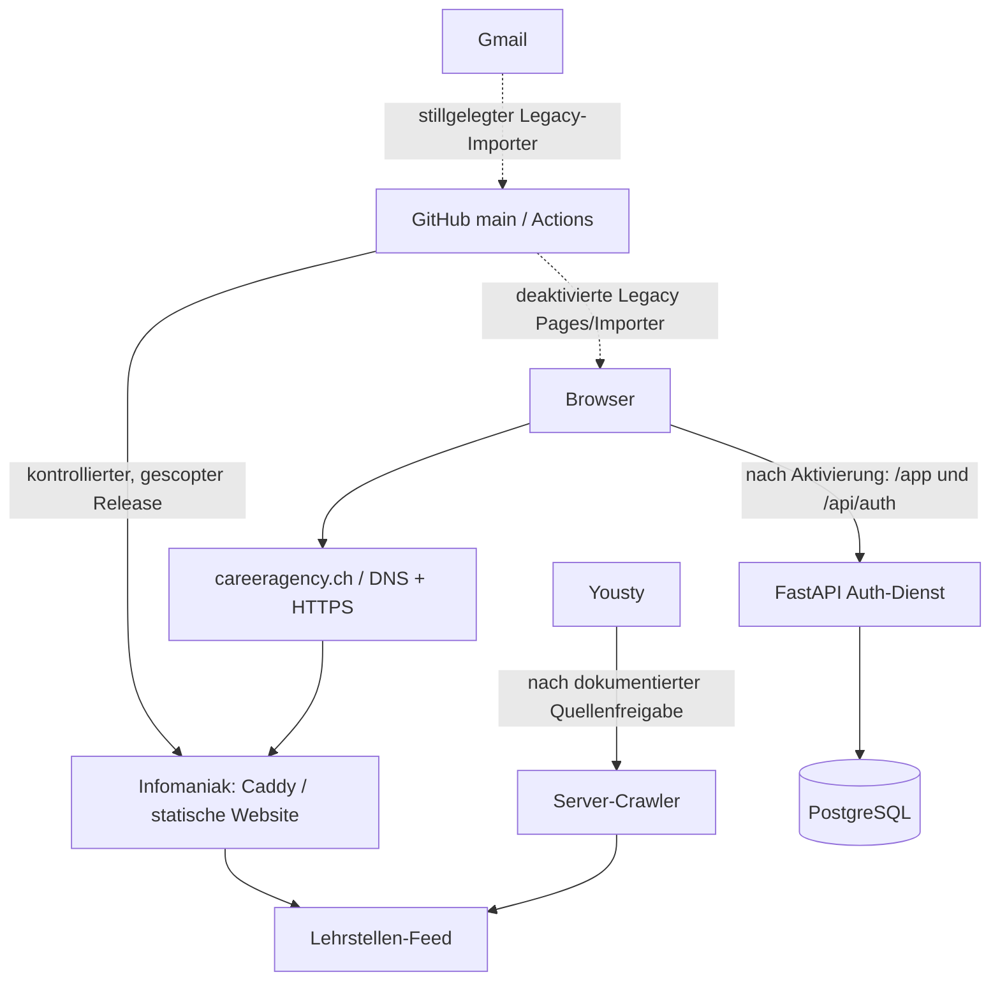

# Career.Agency — Server- und Deploymentlandkarte

Diese Karte trennt Repositorystand, verbindliche Architekturentscheidungen und tatsächlichen Produktionszustand. Keine Zugangsdaten oder Secret-Werte eintragen.

## Prüfstand

| Angabe | Status | Nachweis |
|---|---|---|
| Repository und Zielbranch | **VERIFIZIERT** | Coco1the8creator7/bewerbungs-agent, Standardbranch main |
| geprüfter Repository-Stand | **VERIFIZIERT** | Produktionsaudit am Stand `7ce2df7fd35c2916a1e1b60457eceb273302ae58`, 07.11.2026; Implementierung folgt in diesem Branch/PR. |
| PR-Lage | **VERIFIZIERT** | #115 (UI) in 7685b15 und #118 (Radar-Releasepfad) in be27473 gemergt. |
| aktuelle Serverkonfiguration | **TEILWEISE VERIFIZIERT** | Caddy, Auth-Backend, PostgreSQL und geschützte Kontorouten produktiv aktiv; anonyme Smoke-Checks erfolgreich. Echte Admin-/Mail-/Zwei-Konten-Abnahme offen. |
| Rollout des geprüften Commits | **TEILWEISE VERIFIZIERT** | Auth-Aktivierung erfolgreich. Read-only Frontend-Abgleich meldet eine Abweichung zwischen Live-`index.html` und `main`; vollständiger Frontend-Deploy ist deshalb gesperrt. |
| letzte Prüfung | **VERIFIZIERT** | 07.11.2026; GitHub APIs, scoped SSH-Rollout und direkte anonyme HTTPS-Prüfungen; Details unten. |

## Architekturübersicht

Pfeile zu Auth und Datenbank sind durch den erfolgreichen Aktivierungs- und Live-Plan bestätigt. Der Crawler bleibt ohne dokumentierte Quellenfreigabe deaktiviert.

## Komponenten und Aufgaben

| Komponente | Aufgabe | Status |
|---|---|---|
| dashboard/ | Statisches Frontend, Landingpage und Radar | Live-Landingpage weicht von `main` ab; keine Vollauslieferung bis zum Abgleich produktiver Anpassungen. Scoped Radar-Release ist read-only geprüft. |
| careeragency.ch | Domain in Workflows und Live-Preflight | HTTPS und produktive Kontorouten im serverseitigen Smoke geprüft; Mailzustellung und interaktive Admin-Nutzung offen. |
| Infomaniak / Caddy | Produktionsziel und Reverse Proxy | Caddy aktiv; Auth-/Admin-/Account-/App-Routen im Read-only-Produktionsplan bestätigt. |
| /var/www/careeragency/current | Im SSH-Dispatcher geprüfter Landingpage-Pfad | **AUS REPOSITORY**: status prüft index.html dort. Inhalt und Symlink-Ziel nicht live geprüft. |
| /srv/careeragency-landing-feed/jobs.json | Im Dispatcher geprüfte Feed-Datei | **AUS REPOSITORY**. Abgleich mit lehrstellen.json ist **OFFEN**. |
| authservice/ | FastAPI Authentifizierung und private API | Produktiv aktiv; private Pfade ohne Sitzung verweigert. Reale Kontenabnahme offen. |
| PostgreSQL / careeragency_auth | Auth- und Nutzerdaten gemäß Migrationen | PostgreSQL und Auth-Runtime aktiv; DB-Backup/Restore wurden im Rollout geprüft. Keine DB-Inhalte im Audit ausgegeben. |
| Yousty-Crawler | Zentraler Lehrstellenfeed und Statusprotokoll | Service/Timer sind nach PR #102 **AUS REPOSITORY**; Timer bleibt laut PR ohne dokumentierte Quellenfreigabe deaktiviert. Auf dem Server installiert/aktiv: **OFFEN**. |
| GitHub Pages | Historischer statischer Veröffentlichungsweg | Workflow bleibt manuell startbar, Deploy-Job ist deaktiviert (**AUS REPOSITORY**); live öffentlich erreichbar: **OFFEN**. |
| GitHub Actions | Import, Tests und Veröffentlichung | Definitionen **AUS REPOSITORY**; aktuelle Laufhistorie nicht geprüft. |

## Anfrage- und Datenwege

1. **Statische Webauslieferung — AUS REPOSITORY:** Browser → careeragency.ch → vorgesehene Infomaniak-/Caddy-Auslieferung. deploy-infomaniak.yml ist auf manuellen Start begrenzt und führt nur Prüfungen aus; SFTP-Veröffentlichung ist entfernt. Ein freigegebener, manueller Infomaniak-Rollout ist in docs/production-completion.md beschrieben. Er wurde hier nicht ausgeführt oder live bestätigt.
2. **GitHub Pages — AUS REPOSITORY:** deploy-pages.yml ist stillgelegt; der Deploy-Job ist deaktiviert. Pages ist nicht mehr als Produktionsweg vorgesehen. Ob eine alte Pages-Kopie noch erreichbar ist: **OFFEN**.
3. **Jobmail-Import — AUS REPOSITORY:** alter Gmail-Importer ist mit if: false stillgelegt; Zeitplan und automatisches Schreiben in dashboard/jobs.json sind deaktiviert. Die bisherigen Secret-Namen dürfen nicht als Hinweis auf aktive Nutzung gelten.
4. **Manuelle URLs — AUS REPOSITORY:** alter URL-Importer ist mit if: false stillgelegt; keine Feed-/Pages-Veröffentlichung aus diesem Workflow.
5. **Lehrstellen-Radar — AUS REPOSITORY:** main stellt den Radar auf Lehrstellen um und erwartet ./lehrstellen.json. Live-Route und Inhalt nicht geprüft.
6. **Konten und private Daten — BESCHLOSSEN / AUS REPOSITORY:** eigener FastAPI-Dienst mit PostgreSQL, E-Mail-Verifizierung, manueller Admin-Freigabe und TOTP für Administratoren. Alte IndexedDB-Daten werden nicht automatisch zugeordnet. Dossier-Studio-Dateien und Cloud-Synchronisation sind nicht im aktuellen Loginpfad. Installation und produktive Abnahme: **OFFEN**.
7. **Crawler und Outbox — AUS REPOSITORY:** PR #102 ist gemergt und enthält nutzergetrennte PostgreSQL-Ablage, verschlüsselte Mail-Outbox und begrenzte Yousty-Crawler-Läufe. Dienste, Migrationen, SMTP und Quellennutzungsfreigabe sind auf Produktion noch nicht verifiziert; der Crawler-Timer ist ohne dokumentierte Freigabe deaktiviert.

## Deployment und PR-Ablauf

### Aktueller Repositorystand

- **Infomaniak-Frontend:** deploy-infomaniak.yml ist nur manuell startbar und prüft das Frontend; der frühere SFTP-Deploy wurde entfernt. Produktionsreleases erfordern den in docs/production-completion.md beschriebenen Betreiberablauf.
- **GitHub Pages:** deploy-pages.yml ist stillgelegt; der Job ist deaktiviert. Importworkflows für Gmail und URLs sind ebenfalls deaktiviert.
- **Eingeschränkter SSH-Dispatcher:** ops/server/ca-ops-command enthält eine Befehls-Allowlist. ops/server/install-ops-dispatcher.sh ist laut Code zentraler Installationspunkt und sichert die Vorversion. Skripte belegen keine Übereinstimmung der Serverinstallation.
- **Auth-/Backend-Rollout:** owner-setup.sh und apply-production.sh beschreiben einen interaktiven, betreiberseitigen Installationsweg. Der Merge startet ihn nicht. Ausführung und Aktivierung sind hier nicht belegt; siehe docs/production-completion.md.

### Bei jedem PR

1. Repository, Base-Branch/-SHA, PR-Nummer, Head-SHA, Merge-SHA und geänderte Dateien festhalten.
2. Auswirkungen auf Frontend/API, Domain/Proxy/TLS, Deployment/Rollback, Dienste, Datenbank/Speicher, Firewall/SSH, Jobs/Crawler und Auth/Admin/Datenschutz prüfen.
3. Karte im PR anpassen, wenn Architektur, Deployment oder Serververhalten betroffen sind. Sonst festhalten: „Serverlandkarte geprüft; keine Infrastrukturänderung.“
4. Nach Merge Workflowlauf und Livezustand über freigegebene Read-only-Wege prüfen. Merge, CI, Deployment und Live-Funktion getrennt bewerten.
5. Nur mit aktuellem Laufzeitnachweis als **VERIFIZIERT** markieren. Ohne Nachweis **OFFEN** lassen.
6. Keine Serveränderung, Migration, Neustart, Löschung oder Rechteänderung ohne ausdrücklichen Auftrag.

## Dienste, Ports, Pfade und Daten

| Gegenstand | Angabe | Status |
|---|---|---|
| TCP 80/443 | Erwartete öffentliche Webports für Caddy | **OFFEN**: Listener und Firewall nicht live geprüft. |
| SSH | Eingeschränkter Forced-Command-Zugang für careeragency_runner im Ops-Code vorgesehen | **AUS REPOSITORY**. authorized_keys, sudoers und aktive Rechte nicht abgefragt. |
| Auth API | 127.0.0.1:8765 laut ops/production/careeragency-auth.service | **AUS REPOSITORY**; Unit installiert/aktiv: **OFFEN**. |
| PostgreSQL | Auth-Unit benötigt postgresql.service | **AUS REPOSITORY**; aktiver Dienst/Portbindung nicht live geprüft. |
| Webroot | /var/www/careeragency/current | **AUS REPOSITORY**; Inhalt/Symlink **OFFEN**. |
| Feed | Dispatcher prüft /srv/careeragency-landing-feed/jobs.json; Radar erwartet lehrstellen.json | **OFFEN**: Routing und Dateipfad abgleichen. |
| Auth-Runtime | /opt/careeragency/auth-current; Konfiguration /etc/careeragency/auth.env | **AUS REPOSITORY**; Runtime und Rechte **OFFEN**. Secret-Werte niemals erfassen. |
| PostgreSQL-Daten | careeragency_auth; Migrationen unter db/migrations/ | **AUS REPOSITORY**. Schutzbedarf hoch: Konten, Bewertungen und Aktivitäten. Backup/Restore nicht verifiziert. |
| Ops-Backups | /var/backups/careeragency-ops/dispatchers | **AUS REPOSITORY**; Aufbewahrung/Wiederherstellung **OFFEN**. |

Backend, Datenbank und Adminoberfläche sollen nicht öffentlich lauschen. Die Auth-Unit bindet an Loopback; Proxy-Routen gelten erst nach Installation.

## Schutz- und Berechtigungsgrenzen

- **VERIFIZIERT im Repository:** Workflows referenzieren Secrets über Namen; Werte sind nicht Teil dieser Karte.
- **AUS REPOSITORY:** SSH-Dispatcher verweigert unbekannte Befehle; privilegierte Operationen laufen über festgelegte Programme.
- **AUS REPOSITORY:** Auth-Unit nutzt careeragency_auth als dedizierten Benutzer, Loopback und systemd-Härtungsoptionen.
- **BESCHLOSSEN:** Nutzergetrennte Konten und Aktivitäten; manuelle Admin-Freigabe und Admin-TOTP.
- **OFFEN:** installierte SSH-Key-Einschränkungen, sudoers, UFW/Anbieter-Firewall, Dateirechte, Secret-Verteilung, DB-Rollen, Backup-Verschlüsselung und Restore-Probe.
- **Kritischer Prüfhinweis:** Die alten SFTP-/Pages-/Importer-Workflows sind im Repository deaktiviert. Bereits veröffentlichte GitHub-Pages-Kopien oder alte Serverdateien können dennoch erreichbar sein; ihren aktuellen Status separat prüfen.

## Produktionsprüfung und Rollback

**Heute belegt:** Repository-Stand und Workflow-/Skriptinhalte gemäß obigen Tabellen.

**Heute offen:** Caddy, DNS/TLS, aktive Dateien, Feedroute/-inhalt, systemd, PostgreSQL, Auth-Routen, Crawler-Timer, Firewall, Deployment-SHA und Rollbackfähigkeit. Frühere Konversationsnachweise nannten aktives Caddy und eingeschränkten SSH-Zugang, aber auch abgewiesene oder fehlende Auth-Schritte; das ist kein aktueller Systemnachweis.

### Lesende Prüfungen nach Merge

1. Actions-Lauf des konkreten Merge-SHA und Deploymentziel/URL prüfen.
2. SSH nur über den freigegebenen Dispatcher verwenden: status, release-check <vollständiger SHA> und dedizierte Read-only-Preflights.
3. Öffentlich HTTPS-Status und erwartete Endpunkte prüfen. Auth zusätzlich mit anonymen Negativtests und freigegebenem Testkonto abnehmen.
4. Datenbank/Crawler über Read-only-Status, Migrationstabelle, Timerstatus und letzte Laufprotokolle prüfen.
5. Vor einem Rollback Release-ID und Sicherung prüfen. Rollback nur mit ausdrücklichem Auftrag; danach Status und HTTP erneut prüfen.

Der neue Produktionsgateway kennt plan, lockdown, prepare und activate; Rollbackdetails und Live-Wiederherstellbarkeit stehen in docs/production-completion.md. Installation und aktuelle Sicherungen sind **OFFEN**; Wiederherstellbarkeit gilt ohne Live-Probe nicht als verifiziert.

## Offene Punkte und Risiken

1. **OFFEN — Liveinventar:** Caddy-Routen, Dienste, Dateien, DNS/TLS, Firewall und Deployment-SHA über freigegebenen Read-only-Zugang abrufen.
2. **OFFEN — nach Merge #102:** Merge ist erfolgt, aber der manuelle Betreiber-Bootstrap und die abschließende Liveabnahme sind separat nachzuweisen. Code/Unit/Migrationen im main beweisen keine Installation.
3. **OFFEN — Altbestände:** automatische SFTP-/Pages-/Importer-Wege sind im main deaktiviert. Verifizieren, dass Livehost, alte Pages-Kopie und Legacy-Feeds keine unbeabsichtigten Altinhalte mehr ausliefern.
4. **OFFEN — Feedpfad:** Radar erwartet lehrstellen.json; ältere Ops-Prüfungen referenzieren jobs.json. Proxy und Publisher müssen denselben Feed bereitstellen.
5. **OFFEN — Auth-Abnahme:** Auth, PostgreSQL, SMTP, TOTP, Freigabe, Redirects und 401-Schutz auf dem Zielsystem nachweisen.
6. **OFFEN — Datenschutz:** keine Dossier-Cloudablage im beschlossenen Umfang. Schutz Minderjähriger, Speicherfristen und Exporte vor Synchronisation persönlicher Dokumente klären.
7. **OFFEN — Lehrstellenbetrieb:** Crawler-Timer erst mit dokumentierter Quellenfreigabe aktivieren. Laufzeit, Fehleralarm, Feedroute und öffentliche Ausgabe nach Betreiber-Bootstrap prüfen.

## Eintrag je PR

- PR / Titel:
- Base-Branch und Base-SHA:
- Head-SHA / Merge-SHA:
- Geänderte Infrastruktur- und Anwendungspfade:
- Auswirkungen: Frontend/API | Domain/Proxy/TLS | Deployment/Rollback | Dienste | DB/Speicher | Firewall/SSH | Jobs/Crawler | Auth/Admin/Datenschutz
- Karte: aktualisiert / geprüft und unverändert
- Workflow-Nachweis: Run-ID, Status, SHA
- Produktion: **VERIFIZIERT** / **ungeprüft** / **nicht ausgerollt**
- Live-Prüfmethode, Zeitpunkt und Endpunkte/Dienste:
- Offene Prüfungen / Rollback-Referenz:

## Prüfung zu PR #115 — Landingpage „Daten & Entwicklung“

- **Repository/Base:** `main`, Base-SHA `306b656d0417f0f2ab68259364e7c340493b72eb`, Merge-SHA `7685b15945bab46edc801d78ca64d44c2592f14c`.
- **Änderungen:** `dashboard/index.html` blendet den Footer-Abschnitt `Daten & Entwicklung` und den schwebenden GitHub-Speicherbutton aus; `tests/test_dashboard_contract.py` und `tests/test_landing_cleanup.cjs` prüfen den Zustand.
- **Auswirkungen:** nur Landingpage-UI und Regressionstests; keine API-, Domain-, Caddy-, Server-, Datenbank-, SSH-, Dienst- oder Crawler-Änderung. Die Funktionen und Markup-Elemente bleiben im HTML verborgen, um bestehende Initialisierungen und lokale Datenabläufe intakt zu halten.
- **Workflow-Nachweis:** Dashboard-CI erfolgreich auf PR-Head `7a122fdde2cbdb5cd708bd98eb6a809dd2a78f00` (Run 42389657598).
- **Produktion:** **nicht ausgerollt / nicht verifiziert**. Der geschützte Frontend-Release benötigt GitHub Actions `Career.Agency production deployment` mit Operation `deploy`; der Workflow wurde nicht gestartet.
- **Liveprüfung / Rollback:** nicht ausgeführt. Rollback bleibt auf ein vorheriges `index.html`-Release begrenzt und erfordert dessen Release-ID.

## Prüfung zu PR #108 — Dispatcher-Installer

- **Repository/Base:** main, ffbcc95bb8bb9b6fcdbeb31c6d73fff27d518790. Änderung: `ops/server/install-ops-dispatcher.sh`; Regressionen: `ops/tests/test_dispatcher_upgrade.py`.
- **Verifiziert, lokaler Test:** 31 Ops-Tests erfolgreich. Der Validator unterscheidet nun äussere SSH-Aktionen von verschachtelten Release-Unterfällen; die Befehls-Whitelist bleibt unverändert. Unbekannte äussere Aktionen werden weiterhin abgewiesen.
- **Verifiziert, Betreiber-Terminal vom 07.11.2026:** `owner-setup.sh` brach beim Dispatcher-Validator mit den fälschlich erkannten Unterfällen `release-check|release-deploy`, `release-rollback` und `*` ab. Dieser Abbruch liegt vor Dispatcher-Installation, Gateway-Installation, Migrationen und Dienstaktivierung.
- **Letzter direkter HTTPS-Nachweis (07.11.2026, vor dem erneuten Installationsversuch):** `/` und `/lehrstellen.json` HTTP 200, Feed 185 Yousty-Inserate; `/jobs.json` 401; `/feedback.json` 200; `/account/login`, `/app/`, `/api/auth/me` 404. Auth-Produktivbetrieb ist damit nicht bestätigt; die Feedback-Sperre war noch nicht aktiv.
- **SSH-Nachweis:** Read-only-Plan über [Run 42388395669](https://github.com/Coco1the8creator7/bewerbungs-agent/actions/runs/42388395669) abgewiesen (Exit 64, Befehl nicht auf installierter Allowlist). Das belegt die Erreichbarkeit des eingeschränkten SSH-Zugangs, nicht die Installation des neuen Produktionsgateways.
- **Auswirkungen:** Nur Installationsprüfung/Deployment. Keine UI-, Proxy-, Datenbank-, Auth- oder Whitelist-Erweiterung durch diesen Fix. Die bestehende Sicherung und atomare Dispatcher-Installation bleiben erhalten.
- **Offen:** CI und Merge von PR #108; danach Betreiber-Bootstrap mit aktuellem main wiederholen und erst anschliessend HTTP-, Dienst-, Migrations- und Zugriffsschutzprüfungen aktualisieren. Serverseitiger Rollout dieses Fixes ist noch nicht nachgewiesen.

## Rollout-Fortsetzung nach Betreiberbestätigung (07.11.2026)

- **Verifiziert:** PR #108 gemergt in caed51e698d0e663c49d201d40c9ea508e58dfb3; beide CI-Prüfungen erfolgreich.
- **Verifiziert:** Neuer Produktionsgateway erreichbar: Read-only-Plan [Run 42388967343](https://github.com/Coco1the8creator7/bewerbungs-agent/actions/runs/42388967343) erfolgreich. Auth-Dienst inaktiv, auth.env fehlt, auth-current vorhanden. Kein Secret-Inhalt gelesen.
- **Verifiziert:** Erneuter HTTPS-Abruf: Login/App/private API noch 404; Feedback weiterhin 200; Lehrstellenfeed HTTP 200 mit 185 Einträgen. Installation ist daher noch nicht abgeschlossen.
- **Verifiziert:** Autorisierter Lockdown [Run 42389011901](https://github.com/Coco1the8creator7/bewerbungs-agent/actions/runs/42389011901) vor Änderungen mit Exit 65 abgebrochen. Der bisherige Webroot-Guard verbietet sämtliche current-Symlinks; der kanonische Zielpfad ist noch auszulesen.
- **Korrektur:** Rollout akzeptiert ein geprüftes current-Verzeichnis oder einen Verweis auf ein direktes Release unter /var/www/careeragency/releases. Eigentümer und Schreibrechte sowie Asset-Symlinks werden geprüft; externe Ziele bleiben gesperrt. Der Plan meldet Zielpfad/Dateityp/Rechte, ohne Inhalte oder Secrets auszugeben.
- **Offen:** Korrektur integrieren, Read-only-Plan erneut ausführen, tatsächlichen Zielpfad bestätigen und Lockdown/Backend-Vorbereitung kontrolliert fortsetzen. SMTP und abschliessende Auth-Aktivierung bleiben offen.

## Bestätigter Live-Webroot (07.11.2026)

- Read-only-[Run 42389350307](https://github.com/Coco1the8creator7/bewerbungs-agent/actions/runs/42389350307) erfolgreich: current ist ein Symlink auf `/var/www/careeragency/releases/legacy-hidden-20261106`; Eigentümer ubuntu:ubuntu, Modus 775. Auth weiterhin inaktiv, auth.env fehlt.
- Die Rechteprüfung berücksichtigt administrative Gruppen nur nach tatsächlicher Unix-Mitgliederprüfung. Gruppen-Schreibrecht wird nur akzeptiert, wenn sämtliche primären und zusätzlichen Gruppenmitglieder zur unveränderten Vertrauensmenge root/ubuntu gehören. Welt-Schreibrecht, fremde Eigentümer, unaufgelöste Gruppen und fremde Gruppenmitglieder bleiben gesperrt. Keine Dateirechte werden dadurch verändert.
- 12 lokale Rollout-Tests einschliesslich negativer Rechtefälle erfolgreich. Serverseitiger Lockdown und Backend-Vorbereitung bleiben bis zur erfolgreichen Ausführung unbestätigt.

## Erfolgreiche Produktionsvorbereitung (07.11.2026)

- **Feedback-Sperre VERIFIZIERT:** [Run 42389629129](https://github.com/Coco1the8creator7/bewerbungs-agent/actions/runs/42389629129), code 28cbd71dcda62cb1a99dc5418e188bf3ca6dc19d. Live-Payload reversibel ausserhalb des Webroots gesichert; direkter anschliessender GET /feedback.json HTTP 404. Backup: `/var/backups/careeragency-ops/production/20261107T160652Z-28cbd71dcda6`.
- **Backend-Vorbereitung VERIFIZIERT:** [Run 42389932755](https://github.com/Coco1the8creator7/bewerbungs-agent/actions/runs/42389932755), code 7685b15945bab46edc801d78ca64d44c2592f14c. Runtime installiert, Datenbankdump und Restore-Probe erfolgreich, Migrationstracking und additive Migrationen erfolgreich, 185 bestehende Lehrstellen-IDs als zentraler Pool übernommen. Services/Timer installiert; Auth absichtlich noch nicht gestartet. Backup: `/var/backups/careeragency-ops/production/20261107T161026Z-7685b15945ba`.
- **Konfiguration:** root-only auth.env mit lokal erzeugtem Schlüssel und SMTP-Platzhaltern angelegt. SMTP-Zugangsdaten und initialer Administrator müssen lokal eingegeben werden; reale Zustellung und Admin-TOTP sind NICHT verifiziert. Keine Secrets ausgelesen oder protokolliert.
- **Paralleländerung:** Ein früherer prepare-Versuch mit veraltetem main-SHA wurde vor Änderungen abgewiesen. Der erfolgreiche Lauf berücksichtigt den inzwischen freigegebenen UI-Commit.
- **Aktivierung:** Eine vorbereitete, root-verlinkte Runtime darf nach reinen Dokumentations-/Ops-Änderungen aktiviert werden, wenn ihre Git-Revision Vorfahr des aktuellen main ist und Auth-, Backend-, Crawler-, Dashboard-, Migrations- und Unit-Dateien identisch sind. Änderungen an diesen produktiven Artefakten erzwingen erneutes prepare. Das verhindert, dass die Aktualisierung dieser Landkarte allein ein erneutes Runtime-Deployment verlangt.
- **Konfigurationsbackup:** Vor Aktivierung wird auth.env einschliesslich des Verschlüsselungsschlüssels im root-only Release-Backup gesichert; Werte erscheinen nicht in Logs.
- **Offen:** lokale SMTP-/Admin-Eingabe, Auth-/Caddy-Aktivierung und HTTP-Negativtests; echte E-Mail-Zustellung, Admin-MFA, zwei reale Testkonten und Crawler-Quellenfreigabe. Crawler-Timer bleibt ohne dokumentierte Freigabe deaktiviert. Dossier Studio bleibt ausgeklammert.

## Auth-Aktivierungsprüfung nach SMTP-/Admin-Eingabe (07.11.2026)

- Betreiber-Terminal bestätigt erfolgreiche SMTP-TLS-Anmeldung und lokale Erstellung des ersten Administrators. Kein Passwort/Schlüssel im Chat oder Repository übernommen; echte Mailzustellung und TOTP-Einrichtung weiterhin offen.
- [Aktivierungsversuch 42391932466](https://github.com/Coco1the8creator7/bewerbungs-agent/actions/runs/42391932466) bestätigt `auth_environment=complete` und identische vorbereitete App-/Migrations-/Unit-Dateien (staged 7685b15, current 4b20cd8). Abbruch vor Dienststart/Caddy-Änderung wegen bestehender Request-Transformations-/Auth-Direktive.
- Neuer Read-only-Plan ergänzt eine whitelist-basierte Routing-Zusammenfassung aus `caddy adapt`: Matcher-Hosts/Pfade, Handler-Arten und Statuscodes; keine Auth-Provider-Felder, Benutzernamen, Passwort-Hashes, Headerwerte oder Response-Bodies. Dadurch kann die bestehende Regel geprüft werden, ohne Konfigurationssecrets offenzulegen.
- Lokal 18 Rollout-Tests und 45 Ops-Tests erfolgreich; Datenschutz-Negativtests für Routing-Zusammenfassung enthalten. Öffentliche Auth-Aktivierung weiterhin nicht erfolgt.

## Prüfung der bestehenden Legacy-Authentifizierung (07.11.2026)

- **VERIFIZIERT:** Read-only-[Run 42392386855](https://github.com/Coco1the8creator7/bewerbungs-agent/actions/runs/42392386855) zeigt die einzige `authentication`-Middleware innerhalb des exakten `/jobs.json`-Handlers. Keine globale Authentifizierung oder Request-Umschreibung im gemeldeten Routing. Auth-Provider und Zugangsdaten wurden nicht ausgegeben.
- Der Aktivierungsguard prüft diese Begrenzung erneut anhand der tatsächlich adaptierten Caddy-Konfiguration. Sämtliche OR-Matcher müssen auf exakte Legacy-JSON-Pfade begrenzt sein; globale Authentifizierung, Wildcards und unbeschränkte Geschwisterrouten werden weiterhin abgewiesen. Bestehende Regel bleibt erhalten; neue Kontorouten gehen zum Loopback-Backend.
- **Offen:** erfolgreicher Aktivierungslauf und öffentliche HTTP-Negativtests. SMTP-Anmeldung und Admin-Erstellung sind vom Betreiber bestätigt; echte Mailzustellung und Admin-TOTP bleiben ungeprüft. Keine Dossier-Studio-Änderung.

- **Korrektur zur UI-Erhaltung:** Die erste Auth-Aktivierung kopiert keine öffentlichen HTML-/Radar-/Navigationsdateien mehr. Sie verifiziert den bereits im Lockdown installierten Account-Adapter und aktiviert das separat vorbereitete Backend. Die unabhängig produktiv eingespielten Radar- und Landingpage-Anpassungen bleiben erhalten; bei unbekannt verändertem Adapter Abbruch vor Dienststart.

## Produktive Konten aktiviert — 07.11.2026, 22:25 UTC

- **VERIFIZIERT:** [Aktivierung 42420520894](https://github.com/Coco1the8creator7/bewerbungs-agent/actions/runs/42420520894) erfolgreich, Ops-Commit `d7468e4d68cd5e6e6d3c2970d79438bf5e725892`. Auth-Runtime unverändert `7685b15945bab46edc801d78ca64d44c2592f14c`, Artefaktgleichheit geprüft. Root-only Backup `/var/backups/careeragency-ops/production/20261107T222516Z-d7468e4d68cd`.
- **VERIFIZIERT:** Auth gestartet und für Neustarts aktiviert; Mail-Timer aktiviert und gestartet. Migrationstabellen über lokale Health-Abfrage erreichbar. Caddy-Kandidat validiert, Konfiguration geladen; kein Rollback ausgelöst.
- **VERIFIZIERT:** Server-Smoke: Landingpage und Lehrstellenfeed 200; Login 200; `/jobs.json` und `/feedback.json` 404; private App einschliesslich HTML/JS und Feedbackpfad, Admin sowie private State-API jeweils 401 ohne Sitzung. Unabhängige HTTPS-Abfrage bestätigt diese Statuscodes und Registrierung 200. Browseransicht zeigt funktionsfähiges Loginformular; kein Admin-Login durch die KI.
- **VERIFIZIERT:** Öffentliche Landingpage vor/nach Aktivierung bytegleich, SHA-256 `46befcc89569953786fb0e98f6d6fae3ad297588480959f127996c1c3112b4a5`. Der bereits installierte öffentliche Account-Adapter entspricht main. Keine Dossier-Studio- oder öffentlichen UI-Dateien bei Aktivierung ersetzt.
- **Gefundene Ops-Abweichung:** Die zusätzliche Crawler-Freigabeprüfung lief aus falschem Arbeitsverzeichnis und meldete `ModuleNotFoundError`. Timer blieb deaktiviert. Die Prüfung wechselt künftig in die verifizierte Runtime und unterscheidet fehlende Freigabe von Konfigurationsfehlern. Quellenfreigabe wurde nicht erteilt und kein Crawl gestartet.
- **Nicht verifiziert:** echte Mailzustellung, interaktiver Admin-Login/TOTP und Zwei-Konten-Abnahme auf Produktion. CI prüft Nutzerisolation, Synchronisation, Reload und Logout; dies ersetzt keine produktive Zwei-Konten-Abnahme. Externe Probe `/account.html` ergab 200 mit leerem Body trotz vorgesehener Weiterleitung; kanonischer Login funktioniert. Weiterleitung gesondert prüfen.
- **Status:** eingeschränkt funktionsfähig bis Admin-TOTP, reale Mailzustellung und Kontenabläufe bestätigt sind. Crawler benötigt weiterhin dokumentierte Quellenfreigabe. Dossier Studio bleibt ausgeklammert.

## Abschliessender Live-Plan / Legacy-Kontoweiterleitung (07.11.2026)

- **VERIFIZIERT:** Read-only-Plan nach Aktivierung bestätigt Auth-Dienst und Mail-Timer aktiv/aktiviert; Crawler-Timer inaktiv/deaktiviert. Alle 14 öffentlichen Statusprüfungen erfolgreich, 185 Yousty-Lehrstellen erreichbar.
- **WIDERLEGT:** Die Annahme einer korrekt erzeugten `/account.html`-Weiterleitung. Caddy interpretiert bei `redir /account/login 308` das erste Argument als Pfadmatcher; tatsächlicher Handler hatte Status 302 und wirkte nur unter `/account/login` innerhalb von `/account.html`. Ergebnis 200 mit leerem Body. Der kanonische Login war erreichbar.
- **Korrektur:** `redir * /account/login 308`; exakte Altregel wird auch bei erneuter Aktivierung aktualisiert. CI prüft nun zusätzlich Status und Location im tatsächlich adaptierten Caddy-JSON. Live-Smoke verlangt 308 und exaktes Weiterleitungsziel, statt nur Caddy-Syntax zu prüfen. Keine öffentlichen Frontend-Dateien oder persönlichen Daten verändert.
- **Offen:** produktive Anwendung/Verifikation dieser Redirect-Korrektur; Admin-TOTP, echte Mailzustellung und produktive Zwei-Konten-Abnahme weiterhin offen.

## Abschluss der technischen Auth-Aktivierung (07.11.2026, 22:31 UTC)

- **VERIFIZIERT:** [Rollout 42421025129](https://github.com/Coco1the8creator7/bewerbungs-agent/actions/runs/42421025129) erfolgreich, Ops-Commit `518540116836ed5cb86e71baec0a6359c54f5a08`. Backup `/var/backups/careeragency-ops/production/20261107T223145Z-518540116836`; vorbereitete Runtime unverändert `7685b15945bab46edc801d78ca64d44c2592f14c`.
- Alle **15** öffentlichen Smoke-Prüfungen erfolgreich, einschliesslich Registrierung 200 und korrigierter Legacy-Weiterleitung `/account.html` mit 308 und Location `/account/login`. Der oben beschriebene Redirect-Fehler ist damit **behoben und produktiv verifiziert**.
- Crawler-Freigabeprüfung läuft nun fehlerfrei aus der Runtime: `crawler_timer=disabled source_approval_missing=true`. Kein Crawl und keine Quellenfreigabe vorgenommen.
- [Read-only-Plan 42420819319](https://github.com/Coco1the8creator7/bewerbungs-agent/actions/runs/42420819319) bestätigt Auth-Dienst und Mail-Timer aktiv/aktiviert, Crawler-Timer inaktiv/deaktiviert. Öffentliche Landingpage unverändert; Dossier Studio ausgeklammert.
- **Verbleibende Abnahme:** Administrator meldet sich unter https://careeragency.ch/account/login mit den lokal gesetzten Zugangsdaten an, richtet TOTP ein und sichert Notfallcodes. Reale Mailzustellung, produktive Zwei-Konten-Isolation und dokumentierte Crawler-Quellenfreigabe bleiben offen. SMTP-Anmeldung ist bestätigt; erfolgreiche Anmeldung am SMTP-Server belegt keine Postfachzustellung. Technischer Rollout abgeschlossen, fachliche Ende-zu-Ende-Abnahme eingeschränkt.

## Deployment-Audit: Release-Pfade konsolidiert (07.11.2026)

- **VERIFIZIERT:** Der read-only Live-Plan bestätigt Caddy, Auth-Dienst und Mail-Timer aktiv; Crawler-Timer bleibt aus. Anonyme Prüfungen zeigen Landingpage/Feed/Login/Registrierung erreichbar und private Ressourcen/API geschützt.
- **VERIFIZIERT:** Der `CA-RELEASE`-Workflow im Branch bündelt Backend-Plan/Lockdown/Prepare/Activate sowie Frontend- und Radar-Check/Deploy/Rollback. Er pinnt SSH-Hostschlüssel und verlangt die exakte aktuelle `main`-SHA für SHA-basierte Aktionen; Frontend-/Radar-Änderungen erhalten öffentliche Smoke-Prüfungen und Rollback bei fehlgeschlagenem Deploy-Smoke. Deploy-/Rollback-Schreibpfade wurden nicht durch einen echten Produktionsrelease getestet.
- **VERIFIZIERT:** Der read-only Server-Releasecheck meldet `live_index_differs_from_main`. Der neu ergänzte öffentliche Diff-Check soll die Stellen genauer ausgeben; der erste `CA-RELEASE frontend-check` scheiterte zuvor bereits am installierten Gateway (`unexpected live directory`), weil es `current` als Symlink ablehnt. Das Deployment bleibt gesperrt, bis Live-Unterschied und Gateway-Pfad geprüft sind. Kein Voll-Deploy ausgeführt.
- **VERIFIZIERT:** Radar-Check/Deploy-Test war ein No-op mit `changes: []`; das zeigt SSH-Gateway und Smoke-Pfad, aber keine erfolgreiche produktive Dateiänderung.
- **Korrektur:** Auth-Preflight prüft nun den aktiven Release-Symlink `/opt/careeragency/auth-current/authservice` statt eines nicht vorhandenen alten Direktpfads. Offline-Regressionstest ergänzt.
- **Kritischer Prüfhinweis:** Laufende Backend-Runtime-Updates und Schemaänderungen haben noch keinen regulären Release-/Rollback-Pfad. Diese Änderung behauptet nicht, Backend-Deployment bereits gelöst zu haben. Bis dahin keine Laufzeit-/Schemaänderung über den regulären Releaseweg freigeben; der gebündelte Auth-Rollout bleibt der einzige vorhandene geprüfte Prozess.
- **Kritischer Prüfhinweis:** Admin-TOTP, echte Mailzustellung und Zwei-Konten-Isolation sind nicht abgenommen. Der anonyme HTTP-Smoke belegt Erreichbarkeit und Zugriffsschutz ohne Session, aber keinen erfolgreichen Benutzerablauf.