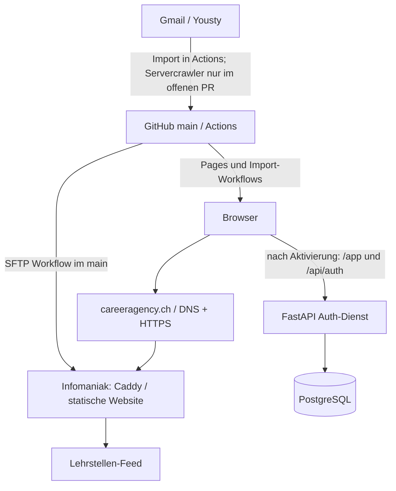

# Career.Agency — Server- und Deploymentlandkarte

Diese Karte trennt Repositorystand, verbindliche Architekturentscheidungen und tatsächlichen Produktionszustand. Keine Zugangsdaten oder Secret-Werte eintragen.

## Prüfstand

| Angabe | Status | Nachweis |
|---|---|---|
| Repository und Zielbranch | **VERIFIZIERT** | Coco1the8creator7/bewerbungs-agent, Standardbranch main |
| geprüfter Repository-Stand | **VERIFIZIERT** | 890b8e53c6d9eab35d5e29466048d2ad6af5c82f, 07.11.2026; GitHub Commit API |
| PR-Lage | **VERIFIZIERT** | #104 gemergt; #102 offen. #102 basiert auf a562f50, vor PRs #103 und #104. |
| aktuelle Serverkonfiguration | **OFFEN** | Bei dieser Bestandsaufnahme kein Live-Statusabruf; frühere Nachweise sind zeitgebunden und teils widersprüchlich. |
| Rollout des geprüften Commits | **OFFEN** | Repository-Commit oder CI allein belegt kein Produktionsdeployment. |
| letzte Prüfung | **VERIFIZIERT** | 07.11.2026; GitHub Repository-, Datei-, Commit- und PR-API; keine Serverabfrage oder Änderung. |

## Architekturübersicht

Pfeile zu Auth, Datenbank und Yousty-Servercrawler bilden Repository-Code oder einen offenen Vorschlag ab; sie bestätigen keine aktiven Produktionsverbindungen.

## Komponenten und Aufgaben

| Komponente | Aufgabe | Status |
|---|---|---|
| dashboard/ | Statisches Frontend, Landingpage und Radar | **AUS REPOSITORY**. PR #104 lädt lehrstellen.json statt des früheren jobs.json. Live-Stand: **OFFEN**. |
| careeragency.ch | Domain in Workflows und Live-Preflight | **AUS REPOSITORY**. DNS-Ziel, aktives Zertifikat und aktuelle Caddy-Routen: **OFFEN**. |
| Infomaniak / Caddy | Produktionsziel und Reverse Proxy | **OFFEN** für aktuellen Host- und Laufzeitzustand. Frühere Gesprächsnachweise ersetzen keinen aktuellen Serverabruf. |
| /var/www/careeragency/current | Im SSH-Dispatcher geprüfter Landingpage-Pfad | **AUS REPOSITORY**: status prüft index.html dort. Inhalt und Symlink-Ziel nicht live geprüft. |
| /srv/careeragency-landing-feed/jobs.json | Im Dispatcher geprüfte Feed-Datei | **AUS REPOSITORY**. Abgleich mit lehrstellen.json ist **OFFEN**. |
| authservice/ | FastAPI Authentifizierung und private API | **AUS REPOSITORY**; produktiv aktiv: **OFFEN**. |
| PostgreSQL / careeragency_auth | Auth- und Nutzerdaten gemäß Migrationen | **AUS REPOSITORY**; aktive Datenbank, Schema, Rollen und Backups nicht geprüft. |
| Yousty-Crawler | Lehrstellenfeed erzeugen | Im aktuellen main kein installierter Server-Timer belegt. PR #102 schlägt Dienst und Timer vor: **OFFEN / nur PR-Vorschlag**. |
| GitHub Pages | Zusätzlicher statischer Veröffentlichungsweg | Workflows existieren (**AUS REPOSITORY**); aktiv/öffentlich: **OFFEN**. |
| GitHub Actions | Import, Tests und Veröffentlichung | Definitionen **AUS REPOSITORY**; aktuelle Laufhistorie nicht geprüft. |

## Anfrage- und Datenwege

1. **Statische Webauslieferung — AUS REPOSITORY:** Browser → careeragency.ch → vorgesehene Infomaniak-/Caddy-Auslieferung. .github/workflows/deploy-infomaniak.yml lädt bei passenden main-Änderungen oder manuellem Start per SFTP. PR-Events deployen nicht. Secret-Namen: INFOMANIAK_SFTP_HOST, INFOMANIAK_SFTP_USER, INFOMANIAK_SFTP_PASSWORD, INFOMANIAK_SFTP_PATH, INFOMANIAK_SSH_KNOWN_HOSTS. Ziel und Secret-Konfiguration sind nicht geprüft.
2. **GitHub Pages — AUS REPOSITORY:** deploy-pages.yml veröffentlicht dashboard/. Importworkflows veröffentlichen Pages ebenfalls. Maßgebliche URL und Parallelbetrieb: **OFFEN**.
3. **Jobmail-Import — AUS REPOSITORY:** GitHub Actions liest Gmail-Abo-E-Mails, normalisiert Inserate und aktualisiert dashboard/jobs.json; der Workflow ist täglich geplant und manuell startbar. Secret-Namen: GMAIL_CLIENT_ID, GMAIL_CLIENT_SECRET, GMAIL_REFRESH_TOKEN. Werte gehören nur in den Secret-Speicher.
4. **Manuelle URLs — AUS REPOSITORY:** import-stellenurls.yml verarbeitet maximal 20 öffentliche URLs und aktualisiert Feed und Pages.
5. **Lehrstellen-Radar — AUS REPOSITORY:** PR #104 stellt den Radar auf Lehrstellen um und erwartet ./lehrstellen.json. Live-Route und Inhalt nicht geprüft.
6. **Konten und private Daten — BESCHLOSSEN / AUS REPOSITORY:** eigener FastAPI-Dienst mit PostgreSQL, E-Mail-Verifizierung, manueller Admin-Freigabe und TOTP für Administratoren. Alte IndexedDB-Daten werden nicht automatisch zugeordnet. Dossier-Studio-Dateien und Cloud-Synchronisation sind nicht im aktuellen Loginpfad. Installation und produktive Abnahme: **OFFEN**.
7. **Crawler und Outbox — OFFEN im main:** PR #102 schlägt nutzergetrennte PostgreSQL-Ablage, verschlüsselte Mail-Outbox und begrenzte Yousty-Crawler-Läufe vor. Nicht als bestehende Produktionsdienste behandeln.

## Deployment und PR-Ablauf

### Aktueller Repositorystand

- **Infomaniak-Frontend:** .github/workflows/deploy-infomaniak.yml; Push auf main mit passenden Pfaden oder manueller Start; Frontend-Prüfungen vor SFTP. Kein PR-Deployment.
- **GitHub Pages:** .github/workflows/deploy-pages.yml veröffentlicht dashboard/. Importworkflows können ebenfalls deployen.
- **Eingeschränkter SSH-Dispatcher:** ops/server/ca-ops-command enthält eine Befehls-Allowlist. ops/server/install-ops-dispatcher.sh ist laut Code zentraler Installationspunkt und sichert die Vorversion. Skripte belegen keine Übereinstimmung der Serverinstallation.
- **Auth-/Backend-Rollout:** Unit und Skripte sind teilweise im Repository. Eine ausgeführte Installation oder Aktivierung ist nicht belegt. PR #102 beschreibt einen offenen Rollout.

### Bei jedem PR

1. Repository, Base-Branch/-SHA, PR-Nummer, Head-SHA, Merge-SHA und geänderte Dateien festhalten.
2. Auswirkungen auf Frontend/API, Domain/Proxy/TLS, Deployment/Rollback, Dienste, Datenbank/Speicher, Firewall/SSH, Jobs/Crawler und Auth/Admin/Datenschutz prüfen.
3. Karte im PR anpassen, wenn Architektur, Deployment oder Serververhalten betroffen sind. Sonst festhalten: „Serverlandkarte geprüft; keine Infrastrukturänderung.“
4. Nach Merge Workflowlauf und Livezustand über freigegebene Read-only-Wege prüfen. Merge, CI, Deployment und Live-Funktion getrennt bewerten.
5. Nur mit aktuellem Laufzeitnachweis als **VERIFIZIERT** markieren. Ohne Nachweis **OFFEN** lassen.
6. Keine Serveränderung, Migration, Neustart, Löschung oder Rechteänderung ohne ausdrücklichen Auftrag.

## Dienste, Ports, Pfade und Daten

| Gegenstand | Angabe | Status |
|---|---|---|
| TCP 80/443 | Erwartete öffentliche Webports für Caddy | **OFFEN**: Listener und Firewall nicht live geprüft. |
| SSH | Eingeschränkter Forced-Command-Zugang für careeragency_runner im Ops-Code vorgesehen | **AUS REPOSITORY**. authorized_keys, sudoers und aktive Rechte nicht abgefragt. |
| Auth API | 127.0.0.1:8765 laut ops/production/careeragency-auth.service | **AUS REPOSITORY**; Unit installiert/aktiv: **OFFEN**. |
| PostgreSQL | Auth-Unit benötigt postgresql.service | **AUS REPOSITORY**; aktiver Dienst/Portbindung nicht live geprüft. |
| Webroot | /var/www/careeragency/current | **AUS REPOSITORY**; Inhalt/Symlink **OFFEN**. |
| Feed | Dispatcher prüft /srv/careeragency-landing-feed/jobs.json; Radar erwartet lehrstellen.json | **OFFEN**: Routing und Dateipfad abgleichen. |
| Auth-Runtime | /opt/careeragency/auth-current; Konfiguration /etc/careeragency/auth.env | **AUS REPOSITORY**; Runtime und Rechte **OFFEN**. Secret-Werte niemals erfassen. |
| PostgreSQL-Daten | careeragency_auth; Migrationen unter db/migrations/ | **AUS REPOSITORY**. Schutzbedarf hoch: Konten, Bewertungen und Aktivitäten. Backup/Restore nicht verifiziert. |
| Ops-Backups | /var/backups/careeragency-ops/dispatchers | **AUS REPOSITORY**; Aufbewahrung/Wiederherstellung **OFFEN**. |

Backend, Datenbank und Adminoberfläche sollen nicht öffentlich lauschen. Die Auth-Unit bindet an Loopback; Proxy-Routen gelten erst nach Installation.

## Schutz- und Berechtigungsgrenzen

- **VERIFIZIERT im Repository:** Workflows referenzieren Secrets über Namen; Werte sind nicht Teil dieser Karte.
- **AUS REPOSITORY:** SSH-Dispatcher verweigert unbekannte Befehle; privilegierte Operationen laufen über festgelegte Programme.
- **AUS REPOSITORY:** Auth-Unit nutzt careeragency_auth als dedizierten Benutzer, Loopback und systemd-Härtungsoptionen.
- **BESCHLOSSEN:** Nutzergetrennte Konten und Aktivitäten; manuelle Admin-Freigabe und Admin-TOTP.
- **OFFEN:** installierte SSH-Key-Einschränkungen, sudoers, UFW/Anbieter-Firewall, Dateirechte, Secret-Verteilung, DB-Rollen, Backup-Verschlüsselung und Restore-Probe.
- **Kritischer Prüfhinweis:** Im aktuellen main existieren SFTP- und GitHub-Pages-Wege. PR #102 will ältere Wege stilllegen. Bis Repository und Produktion abgeglichen sind, ist mit mehreren Veröffentlichungszielen zu rechnen.

## Produktionsprüfung und Rollback

**Heute belegt:** Repository-Stand und Workflow-/Skriptinhalte gemäß obigen Tabellen.

**Heute offen:** Caddy, DNS/TLS, aktive Dateien, Feedroute/-inhalt, systemd, PostgreSQL, Auth-Routen, Crawler-Timer, Firewall, Deployment-SHA und Rollbackfähigkeit. Frühere Konversationsnachweise nannten aktives Caddy und eingeschränkten SSH-Zugang, aber auch abgewiesene oder fehlende Auth-Schritte; das ist kein aktueller Systemnachweis.

### Lesende Prüfungen nach Merge

1. Actions-Lauf des konkreten Merge-SHA und Deploymentziel/URL prüfen.
2. SSH nur über den freigegebenen Dispatcher verwenden: status, release-check <vollständiger SHA> und dedizierte Read-only-Preflights.
3. Öffentlich HTTPS-Status und erwartete Endpunkte prüfen. Auth zusätzlich mit anonymen Negativtests und freigegebenem Testkonto abnehmen.
4. Datenbank/Crawler über Read-only-Status, Migrationstabelle, Timerstatus und letzte Laufprotokolle prüfen.
5. Vor einem Rollback Release-ID und Sicherung prüfen. Rollback nur mit ausdrücklichem Auftrag; danach Status und HTTP erneut prüfen.

Der Repository-Dispatcher kennt release-check, release-deploy und release-rollback. Installierte Helfer und Wirkung sind **OFFEN**. Wiederherstellbarkeit gilt ohne aktuelle Probe nicht als verifiziert.

## Offene Punkte und Risiken

1. **OFFEN — Liveinventar:** Caddy-Routen, Dienste, Dateien, DNS/TLS, Firewall und Deployment-SHA über freigegebenen Read-only-Zugang abrufen.
2. **OFFEN — PR #102:** nicht gemergt und auf älterem main-Basisstand; vor Merge Rebase/Konflikte und Workflows prüfen. Services/Migrationen daraus sind nicht Produktionsbestand.
3. **OFFEN — Veröffentlichungsziel:** SFTP nach Infomaniak und GitHub Pages bestehen im main. Maßgebliches Ziel und Parallelbetrieb festlegen.
4. **OFFEN — Feedpfad:** Radar erwartet lehrstellen.json; ältere Ops-Prüfungen referenzieren jobs.json. Proxy und Publisher müssen denselben Feed bereitstellen.
5. **OFFEN — Auth-Abnahme:** Auth, PostgreSQL, SMTP, TOTP, Freigabe, Redirects und 401-Schutz auf dem Zielsystem nachweisen.
6. **OFFEN — Datenschutz:** keine Dossier-Cloudablage im beschlossenen Umfang. Schutz Minderjähriger, Speicherfristen und Exporte vor Synchronisation persönlicher Dokumente klären.
7. **OFFEN — alte Imports:** Gmail-Workflow kann öffentliche Jobdaten in main committen und Pages auslösen. Aktive Zeitpläne/Secrets sind nicht geprüft; historischen Jobmail-Pfad nicht mit Lehrstellenfokus verwechseln.

## Eintrag je PR

- PR / Titel:
- Base-Branch und Base-SHA:
- Head-SHA / Merge-SHA:
- Geänderte Infrastruktur- und Anwendungspfade:
- Auswirkungen: Frontend/API | Domain/Proxy/TLS | Deployment/Rollback | Dienste | DB/Speicher | Firewall/SSH | Jobs/Crawler | Auth/Admin/Datenschutz
- Karte: aktualisiert / geprüft und unverändert
- Workflow-Nachweis: Run-ID, Status, SHA
- Produktion: **VERIFIZIERT** / **ungeprüft** / **nicht ausgerollt**
- Live-Prüfmethode, Zeitpunkt und Endpunkte/Dienste:
- Offene Prüfungen / Rollback-Referenz:
